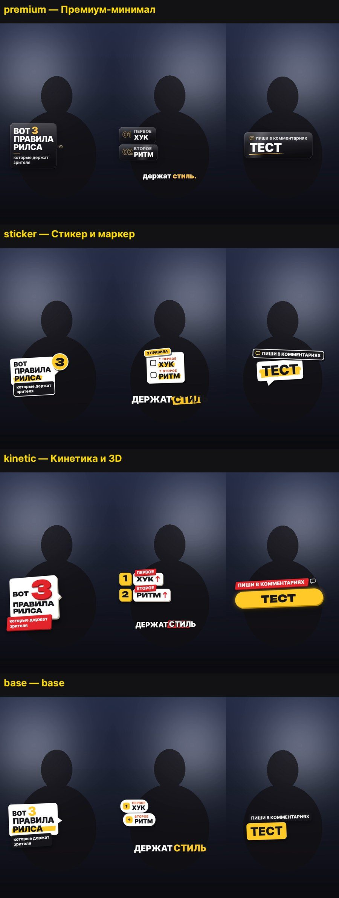

# reels-motion — рилс с моушн-оформлением для Claude Code

<p align="center"></p>

Скилл для [Claude Code](https://claude.com/claude-code). Даёте сырые вертикальные видео, где человек говорит в камеру, — Claude собирает готовый рилс: режет дубли по звуку, ставит стоп-кадр-обложку, где говорящий показывает пальцем на плашку, оформляет хук, лид, блоки, петли и призыв плашками в выбранном стиле, накладывает субтитры по словам, двигает камеру, синтезирует звуки и музыку и проверяет результат по кадрам.

Всё локально: ffmpeg, headless Chromium через Playwright, numpy. Платный только шаг распознавания речи (fal whisper, ключ — ваш).

## Что умеет

- **Монтаж говорящей головы:** разведка исходников (поворот, HDR айфона → BT.709), распознавание по словам с проверкой скрытых повторов замедленной перерасшифровкой, резы по огибающей звука, сетка кадров с проверкой их числа.
- **Шаблоны сценария:** А — хук, лид, три блока с открытыми петлями, призыв с кодовым словом; Б — вопрос, эмоция, последствия в 3–4 сферах, ответ.
- **Библиотека элементов:** плашка хука со стоп-кадром и жестом, список лида, карточки блоков, петли, призыв, стикеры, реакции 🔥 😮 👍 ❤ ⭐ с отскоком и частицами, пузырь «ответ на комментарий», стрелки и выноски (в том числе линия от пальца к плашке), прогресс и счётчик, акцентные слова, субтитры (pop, караоке, маркер, чистые), whip и вспышки, панч-ин и микротряска.
- **Стиль — данные.** Стиль описывается файлом `style.json`: цвета, шрифты, форма плашек, кривые и длительности анимации, вид субтитров, камера, переходы, звук. Новый стиль делается по описанию или по референсу без правки движка. Стили смешиваются: например, плашки одного стиля и субтитры другого.
- **Звук:** голос — только гигиена; SFX синтезом ровно на кадр появления; музыка синтезом с приседанием под голос; −14 LUFS, true peak ≤ −1.
- **Приёмка:** безопасная зона Reels, накладки не на лице, SFX на кадре, LUFS и цвет, листы кадров для просмотра глазами, обратная расшифровка звука.

Главное в скилле — порядок работы. Стиль выбирается вместе с пользователем до рендера, тест стиля на 4 с показывается до полного прогона, «готово» говорится только после проверок.

## Пресеты стилей

| Стиль | Характер |
|---|---|
| `premium` | тёмное матовое стекло, тонкая светлая обводка, тёплый акцент, контурные цифры 01–03, раскрытие из-под маски, засвет на швах |
| `sticker` | белая вырубка с жёсткой тенью, жёлтый маркер с неровным краем, круглые стикеры-номера, пружины с перелётом |
| `kinetic` | плиты влетают из глубины, двери на петлях, экструзия, красные скошенные теги, счётчик 1/N, whip и вспышка на швах |
| `base` | нейтральная основа: всё нарисовано по токенам — с неё удобно начинать свой стиль |

Пресеты — примеры, а не предел. Свои стили лежат в `~/.reels-motion/styles` (или в каталогах из `REEL_STYLES`) и подхватываются сами; обновление скилла их не трогает. Как устроен стиль и как сделать новый — [reference/styles.md](reference/styles.md).

## Установка

Как плагин — в Claude Code:

```
/plugin marketplace add IliaBatko39/reels-motion
/plugin install reels-motion@reels-motion
```

Или вручную, как обычный скилл:

```bash
git clone https://github.com/IliaBatko39/reels-motion ~/.claude/skills/reels-motion
```

Зависимости (команды работают из любой папки):

```bash
python3 -m pip install "playwright>=1.59" "numpy>=2.2" "pillow>=12.1" "scipy>=1.15" "soundfile>=0.13" "opencv-python-headless>=4.10" "psutil>=7.0"
python3 -m playwright install chromium
sudo apt install ffmpeg        # macOS: brew install ffmpeg
```

На Ubuntu 23.04+ и Debian 12 системный pip закрыт (`externally-managed-environment`) — поставьте пакеты в venv и запускайте Claude Code из него:

```bash
python3 -m venv ~/.venvs/reels-motion && source ~/.venvs/reels-motion/bin/activate
python3 -m pip install -r ~/.claude/skills/reels-motion/requirements.txt   # путь — куда установлен скилл
python3 -m playwright install chromium
claude
```

Для распознавания речи нужен ключ fal (https://fal.ai) в переменной окружения `FAL_KEY`. Без него работает всё, кроме шагов `stt` и `qa --stt`.

Проверить окружение — вызовите скилл в Claude Code:

```
/reels-motion:reels-motion проверь окружение
```

При ручной установке команда короче: `/reels-motion проверь окружение`. Из клона репозитория — `python3 scripts/check_env.py`.

## Быстрый старт

Синтетическое демо — без чужого видео: фон-заглушка, вместо голоса тишина, звуки и музыка синтезом. Собирается из коробки за несколько минут и проверяет всю установку:

```bash
python3 engine/reel.py demo --style sticker --out /tmp/reels-demo
```

На выходе `/tmp/reels-demo/demo_sticker.mp4`, ТГ-версия, обложка, листы кадров в `sheets/` и отчёт приёмки (`PASS` по каждому пункту). Шаблон Б: `--template B`. Другой стиль: `--style premium`, `kinetic`, `base`.

Превью стилей и тест своего:

```bash
python3 engine/reel.py styles --preview --out /tmp/reels-preview
python3 engine/reel.py style-new neon --from base         # правите ~/.reels-motion/styles/neon/style.json
python3 engine/reel.py style-test neon --out /tmp/neon-test
```

С настоящим видео просто попросите Claude обычными словами:

- «Смонтируй рилс из этих клипов по шаблону А, плашки и субтитры по словам»
- «Сделай моушн-оформление ролика, первый кадр — где я показываю пальцем на плашку»
- «Оформи ролик в стиле как на этом скрине»

Если Claude не подхватил скилл сам, вызовите его явно: `/reels-motion:reels-motion` и задача следом (при ручной установке — `/reels-motion`).

Конвейер по шагам и все команды — в [SKILL.md](SKILL.md). Схема таймлайна — [reference/timeline-schema.md](reference/timeline-schema.md), примеры — [examples/](examples/).

## Требования

- Python 3.10+, ffmpeg 4.4+ с libx264, `loudnorm`, `alimiter`, `sidechaincompress`, `qtrle`.
- Playwright с Chromium. Видеокарта не нужна.
- 2–4 ГБ свободной памяти. Рендер одного кадра 1080×1920 — около 0,5 с, кадры со смазом движения — около 2 с; минутный ролик — 15–25 минут на обычном сервере.
- Для распознавания — ключ fal (`FAL_KEY`).

## Лицензии

Код — MIT ([LICENSE](LICENSE)). Шрифты в `fonts/` — SIL Open Font License 1.1: Inter ([fonts/OFL-Inter.txt](fonts/OFL-Inter.txt)) и Unbounded ([fonts/OFL-Unbounded.txt](fonts/OFL-Unbounded.txt)). Звуки и музыка синтезируются — внешних аудиофайлов нет.
